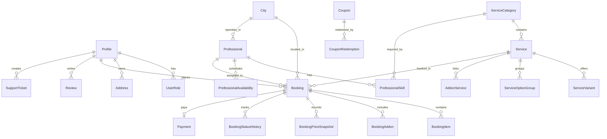
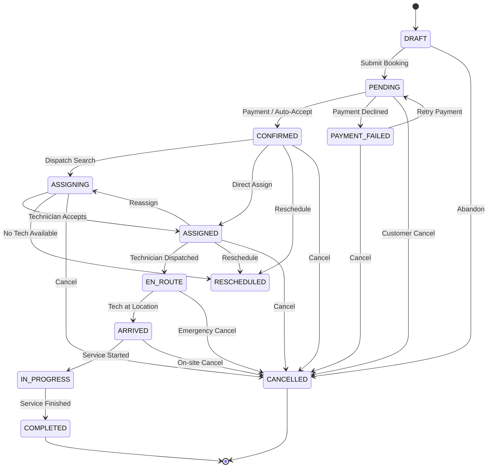

# ServicePlus 🛠️

> **Enterprise Full-Stack On-Demand Home Services Booking & Workforce Operations Platform**

ServicePlus is a modern, production-ready, full-stack home services marketplace and operations management system. Built with **React 19**, **TanStack Start (SSR)**, **NestJS 11**, **Prisma ORM**, **PostgreSQL**, and **Redis**, it delivers an end-to-end booking experience for customers and a comprehensive back-office operations suite for administrators, dispatchers, and service providers.

---

## 📑 Table of Contents

- [Key Features](#-key-features)
  - [Customer Experience](#-customer-experience)
  - [Admin Operations Hub](#-admin-operations-hub)
- [System Architecture](#-system-architecture)
- [Tech Stack](#-tech-stack)
- [Repository Structure](#-repository-structure)
- [Prerequisites](#-prerequisites)
- [Getting Started](#-getting-started)
  - [1. Clone Repository](#1-clone-repository)
  - [2. Backend Setup](#2-backend-setup)
  - [3. Database Setup with Prisma](#3-database-setup-with-prisma)
  - [4. Frontend Setup](#4-frontend-setup)
- [Environment Configuration](#-environment-configuration)
  - [Backend (`backend/.env`)](#backend-backendenv)
  - [Frontend (`frontend/.env`)](#frontend-frontendenv)
- [Database Schema & Data Model](#-database-schema--data-model)
- [Booking Lifecycle & State Machine](#-booking-lifecycle--state-machine)
- [Dynamic Pricing Engine](#-dynamic-pricing-engine)
- [API Reference](#-api-reference)
  - [Authentication & User Profile](#authentication--user-profile)
  - [Services & Catalog](#services--catalog)
  - [Booking & Availability](#booking--availability)
  - [Geo & Media](#geo--media)
  - [Admin Management](#admin-management)
  - [Health & Monitoring](#health--monitoring)
- [Development & Production Commands](#-development--production-commands)
- [License](#-license)

---

## ✨ Key Features

### 🛍️ Customer Experience

* **Interactive Service Catalog**: Browse services categorized by Cleaning, AC Maintenance, Plumbing, Handyman, Electrical, Pest Control, Painting, and more.
* **Flexible Booking Models**:
  * **Fixed Price**: Flat-rate upfront services.
  * **Hourly Custom**: Customizable hours, number of professionals, and materials toggle with dynamic pricing.
  * **Options & Variants**: Multi-item and variant-level configuration (e.g., room counts, AC unit types, deep cleaning tiers).
  * **Add-on Services**: Selectable upsells with real-time price calculation.
* **Recurring Booking Discounts**: Built-in savings for recurring frequencies (*One-Time*, *Bi-Weekly - 5% off*, *Weekly - 10% off*, *Multi-Weekly - up to 25% off*).
* **Smart Availability & Scheduling**: Real-time slot availability checks, duration-aware scheduling, and temporary slot holds.
* **Location & Geolocation**: Mapbox integration with GPS reverse-geocoding, address autocomplete, and multi-address management (Home, Office, Other).
* **Coupon & Promotion Engine**: Instant code validation with percentage or fixed discounts, minimum cart amounts, and maximum discount caps.
* **Passwordless Authentication**: Fast, secure mobile phone OTP login (Mock or Twilio integration) with automatic user account provisioning.
* **Customer Self-Service Hub**:
  * Real-time booking status tracking and timeline history.
  * Self-service booking cancellation (with domain transition guards).
  * Address book management.
  * In-app support ticket submission.
* **Multi-Lingual & Localization (i18n)**: Native English (`en`) and Arabic (`ar`) support with dynamic RTL / LTR layout switching and localized catalog content.

### 🏢 Admin Operations Hub

* **Live Analytics & KPI Dashboard**: Real-time monitoring of revenue, booking volume, customer acquisition, technician availability, and active orders.
* **Visual Catalog Management**:
  * Full CRUD for Services, Categories, Inclusions, FAQs, and SEO metadata.
  * Variant & Option Group builder for complex hierarchical service customization.
  * Add-on service links and bundle package builder.
  * English and Arabic localization fields across all catalog entities.
* **Dispatch & Booking Operations**:
  * Comprehensive booking grid with filtering by status, date, city, customer, and assigned technician.
  * Interactive booking detail modal with full line-item breakdowns, pricing snapshots, and status history logs.
  * One-click technician assignment and status progression state machine.
  * Calendar / dispatch scheduling board.
* **Workforce & Partner Management**:
  * Professional technician profiles, ratings, completed job metrics, and assigned working hours.
  * Category skill mapping and weekly availability matrix per technician.
  * Partner contractor company profiles and supervisor/team lead hierarchies.
  * Document expiration and compliance tracking (visas, trade licenses, IDs).
* **Materials & Inventory**:
  * Materials catalog and unit price management.
  * Technician material requests and approval workflows.
* **Financials & Promotions**:
  * Coupon management (discount types, usage limits, validity periods, first-order restrictions).
  * Tiered pricing rules, city surcharges, and payment audit logs.
  * Refund processing and tracking.
* **Customer Relationship Management (CRM)**:
  * Customer profiles, total spend, booking history, and stored addresses.
  * Integrated customer support ticketing system with two-way threaded messaging.
  * Review moderation and rating aggregation.
* **Governance & Audit Trail**:
  * Role-Based Access Control (Admin, Staff, Professional, Customer) and granular role permission matrices.
  * Comprehensive audit logging tracking all administrative actions with before/after JSON diffs.
  * Dynamic key-value system settings editor.

---

## 🏛️ System Architecture

```
                                  ┌───────────────────────────────┐
                                  │   Client (Browser / Mobile)   │
                                  └───────────────┬───────────────┘
                                                  │
                                                  ▼
                        ┌──────────────────────────────────────────────────┐
                        │       Frontend: React 19 + TanStack Start        │
                        │  (SSR, TanStack Router, TanStack Query, Tailwind) │
                        └─────────────────────────┬────────────────────────┘
                                                  │ HTTP REST / JSON
                                                  ▼
                        ┌──────────────────────────────────────────────────┐
                        │            Backend: NestJS 11 REST API           │
                        │    (Modular Architecture, JWT Auth, Class-Val)   │
                        └───────┬──────────────┬──────────────┬────────────┘
                                │              │              │
                                ▼              ▼              ▼
                    ┌──────────────────┐ ┌───────────┐ ┌──────────────────┐
                    │  Prisma 6 ORM    │ │ Redis     │ │ Storage Engine   │
                    │  PostgreSQL      │ │ (BullMQ / │ │ (Local /         │
                    │  (Neon Cloud)    │ │  Cache)   │ │  Cloudflare R2)  │
                    └──────────────────┘ └───────────┘ └──────────────────┘
```

---

## 💻 Tech Stack

### Frontend
| Technology | Description |
| :--- | :--- |
| **React 19** | Modern UI library leveraging latest React Server Components & Actions |
| **TanStack Start** | Full-stack SSR framework powered by Vite & Nitro |
| **TanStack Router** | 100% type-safe, file-based routing architecture |
| **TanStack Query v5** | Server-state synchronization, caching, and optimistic mutations |
| **Tailwind CSS v4** | Next-generation utility-first styling engine |
| **shadcn/ui & Radix UI** | Accessible, unstyled UI primitives and components |
| **Mapbox GL** | Interactive map rendering, geocoding, and address picking |
| **React Hook Form + Zod** | High-performance form state handling and schema validation |
| **Recharts & Sonner** | Interactive admin data visualization and toast notification system |

### Backend
| Technology | Description |
| :--- | :--- |
| **NestJS 11** | Enterprise-grade, TypeScript-based Node.js backend framework |
| **Prisma ORM 6** | Next-generation type-safe ORM for database modeling and migrations |
| **PostgreSQL (Neon)** | Serverless relational database with ACID compliance |
| **Redis / Redis Cloud** | In-memory store for BullMQ background queues, caching, and rate limiting |
| **Passport & JWT** | Stateless authentication with access & refresh token strategy |
| **Cloudflare R2 / AWS S3** | Object storage with presigned URLs and local fallback provider |
| **Sharp** | High-performance image processing and optimization |
| **Socket.IO** | Real-time WebSocket communication for notifications and dispatching |

---

## 📂 Repository Structure

```
serviceplus/
├── backend/                     # NestJS REST API Server
│   ├── src/
│   │   ├── admin/               # Admin operations, catalog, CRM, workforce
│   │   ├── auth/                # OTP authentication, JWT strategy & guards
│   │   ├── availability/        # Technician scheduling & slot calculator
│   │   ├── booking/             # Booking engine, quote calculation, address management
│   │   ├── common/              # Modular providers (OTP, Payments, Storage, Notifications)
│   │   ├── domain/              # Core domain types, state machines & transition rules
│   │   ├── geo/                 # Mapbox & reverse-geocoding service
│   │   ├── health/              # Health check, liveness & readiness probes
│   │   ├── media/               # File uploads, image handling & storage
│   │   ├── pricing/             # Centralized pricing & discount calculation engine
│   │   ├── prisma/              # Prisma database client integration
│   │   ├── services/            # Public services, category & bundle catalog
│   │   ├── app.module.ts        # Root NestJS application module
│   │   └── main.ts              # NestJS bootstrap, CORS, validation pipes
│   ├── package.json
│   └── tsconfig.json
│
├── frontend/                    # TanStack Start SSR Application
│   ├── src/
│   │   ├── frontend/
│   │   │   ├── components/      # UI components (Navbar, Footer, Search, LocationPicker)
│   │   │   │   ├── admin/       # Admin tables, forms, modals, schedules, permission matrix
│   │   │   │   ├── layout/      # Application layout components
│   │   │   │   └── ui/          # Radix / shadcn/ui design components
│   │   │   ├── hooks/           # Custom React hooks
│   │   │   └── lib/             # API clients, auth context, i18n locale strings, money utils
│   │   ├── routes/              # TanStack Router file-based route definitions
│   │   │   ├── index.tsx        # Homepage (hero, category carousel, featured services)
│   │   │   ├── booking.$slug.tsx# Interactive multi-step booking checkout flow
│   │   │   ├── services.$slug.tsx# Service details and options
│   │   │   ├── categories.$slug.tsx# Category listings
│   │   │   ├── dashboard.tsx    # Customer dashboard & booking tracker
│   │   │   ├── auth.tsx         # OTP login & profile onboarding
│   │   │   ├── admin.*.tsx      # Admin dashboard pages (Bookings, Catalog, Staff, etc.)
│   │   │   └── __root.tsx       # Root layout shell with AuthProvider and LocaleProvider
│   │   ├── router.tsx           # Router configuration & query client setup
│   │   ├── server.ts            # SSR entry handler
│   │   └── styles.css           # Tailwind CSS v4 stylesheets
│   ├── package.json
│   └── vite.config.ts
│
├── prisma/
│   └── schema.prisma            # Unified PostgreSQL database schema (26+ models)
├── .env.example
├── .gitignore
└── README.md
```

---

## ⚡ Prerequisites

Before running the project locally, ensure you have the following installed:

* **Node.js**: `v20.0.0` or higher
* **npm**: `v10.0.0` or higher (or `pnpm` / `yarn`)
* **PostgreSQL Database**: A running PostgreSQL instance or a free serverless database on [Neon](https://neon.tech/)
* **Redis** *(Optional for dev, recommended)*: Local Redis instance or free cloud database on [Redis Cloud](https://redis.io/cloud/)

---

## 🚀 Getting Started

### 1. Clone Repository

```bash
git clone https://github.com/SomanAbbasi/ServicePlus.git
cd ServicePlus
```

---

### 2. Backend Setup

1. Navigate to the `backend` directory:
   ```bash
   cd backend
   ```

2. Copy the example environment file and configure your credentials:
   ```bash
   cp .env.example .env
   ```

3. Install dependencies:
   ```bash
   npm install
   ```

---

### 3. Database Setup with Prisma

Generate the Prisma Client and apply database schema migrations:

```bash
# In the backend directory:
npx prisma generate
npx prisma migrate dev --name init
```

*(Optional)* Launch Prisma Studio to visually inspect and seed database tables:
```bash
npx prisma studio
```

Start the backend development server:
```bash
npm run start:dev
```
The API server will be available at **`http://localhost:3001/api`**.

---

### 4. Frontend Setup

1. Open a new terminal tab and navigate to the `frontend` directory:
   ```bash
   cd frontend
   ```

2. Copy the example environment file:
   ```bash
   cp .env.example .env
   ```

3. Install frontend dependencies:
   ```bash
   npm install
   ```

4. Start the frontend development server:
   ```bash
   npm run dev
   ```
The frontend application will be running at **`http://localhost:3000`** (or `http://localhost:5173`).

---

## 🔐 Environment Configuration

### Backend (`backend/.env`)

| Variable | Required | Default | Description |
| :--- | :---: | :--- | :--- |
| `NODE_ENV` | Yes | `development` | Environment mode (`development`, `production`, `test`) |
| `PORT` | Yes | `3001` | Port number for the NestJS API server |
| `API_PREFIX` | No | `api` | Global API route prefix |
| `FRONTEND_URL` | Yes | `http://localhost:3000` | Allowed CORS origin URL for the frontend |
| `DATABASE_URL` | Yes | - | PostgreSQL connection string (Neon or standard Postgres) |
| `REDIS_URL` | No | - | Redis connection URL for queues and caching |
| `JWT_SECRET` | Yes | - | Secret key used for signing JWT tokens |
| `JWT_EXPIRES_IN` | No | `15m` | Access token expiration duration |
| `JWT_REFRESH_EXPIRES_IN` | No | `7d` | Refresh token expiration duration |
| `ADMIN_PHONES` | No | - | Comma-separated phone numbers auto-granted `admin` role upon OTP login |
| `OTP_PROVIDER` | No | `mock` | OTP delivery provider (`mock` or `twilio`) |
| `TWILIO_ACCOUNT_SID` | No | - | Twilio Account SID (if using `twilio` provider) |
| `TWILIO_AUTH_TOKEN` | No | - | Twilio Auth Token (if using `twilio` provider) |
| `TWILIO_VERIFY_SERVICE_SID`| No | - | Twilio Verify Service SID |
| `PAYMENT_PROVIDER` | No | `mock` | Payment gateway provider (`mock` or `telr`) |
| `STORAGE_PROVIDER` | No | `local` | Media storage provider (`local` or `r2`) |
| `STORAGE_LOCAL_PATH` | No | `./storage` | Directory path for local file storage uploads |
| `R2_ACCOUNT_ID` | No | - | Cloudflare R2 Account ID (if using `r2` provider) |
| `R2_BUCKET` | No | - | Cloudflare R2 Bucket name |
| `R2_ACCESS_KEY` | No | - | Cloudflare R2 Access Key ID |
| `R2_SECRET_KEY` | No | - | Cloudflare R2 Secret Access Key |
| `R2_PUBLIC_URL` | No | - | Public URL base for Cloudflare R2 bucket assets |
| `MAPBOX_API_KEY` | No | - | Mapbox API token for server-side geocoding queries |

### Frontend (`frontend/.env`)

| Variable | Required | Default | Description |
| :--- | :---: | :--- | :--- |
| `VITE_API_BASE_URL` | Yes | `http://localhost:3001/api` | Base URL of the backend API endpoint |
| `VITE_MAPBOX_ACCESS_TOKEN` | No | - | Mapbox public access token for interactive map rendering |

---

## 🗄️ Database Schema & Data Model

The database is built on **PostgreSQL** managed through **Prisma ORM**, organized across several core domains:



### Core Entities:
1. **User & Identity**: `Profile`, `UserRole` (`admin`, `staff`, `professional`, `customer`), `PhoneAuthSecret`, `OtpCode`.
2. **Geography**: `Country`, `City` (with configurable surcharge percentages and active status), `Address` (with coordinates).
3. **Catalog & Services**: `ServiceCategory`, `Service`, `ServiceVariant`, `ServiceOptionGroup`, `ServiceRelation`, `Addon`, `Bundle`, `BundleItem`.
4. **Workforce**: `Professional`, `ProfessionalSkill`, `ProfessionalAvailability`.
5. **Bookings & Orders**: `Booking`, `BookingItem`, `BookingAddon`, `BookingPriceSnapshot`, `BookingStatusHistory`, `SlotHold`.
6. **Finance & Promotions**: `Coupon`, `CouponRedemption`, `Payment`, `Refund`.
7. **Support & Governance**: `SupportTicket`, `SupportMessage`, `Review`, `Notification`, `AuditLog`, `Setting`, `JobQueue`.

---

## 🔄 Booking Lifecycle & State Machine

Every booking transitions through an enforced state machine governed by domain transition rules:



* **Customer Cancellable States**: `PENDING`, `CONFIRMED`, `ASSIGNING`, `ASSIGNED`, `RESCHEDULED`.
* **Lock-in States**: Once a technician is `EN_ROUTE`, `ARRIVED`, or `IN_PROGRESS`, administrative authorization is required for cancellations.

---

## 💰 Dynamic Pricing Engine

The centralized pricing engine (`PricingServiceEngine`) calculates booking costs deterministically:

$$\text{Subtotal} = \text{Base Price (Hourly or Fixed)} + \sum \text{Variant Items}$$

$$\text{Pre-Discount Total} = \text{Subtotal} + \sum \text{Addons} + \text{Materials Cost}$$

$$\text{Surcharge} = \frac{\text{Pre-Discount Total} \times \text{City Surcharge \%}}{100}$$

$$\text{Coupon Discount} = \min\left(\text{Calculated Coupon Value}, \text{Max Discount Cap}\right)$$

$$\text{Frequency Discount} = \frac{(\text{Pre-Discount} + \text{Surcharge} - \text{Discount}) \times \text{Frequency Discount \%}}{100}$$

$$\text{Total Amount} = \text{Taxable Total} + \text{Service Fees} + \text{Taxes}$$

---

## 🔌 API Reference

### Authentication & User Profile
| Method | Endpoint | Access | Description |
| :--- | :--- | :--- | :--- |
| `POST` | `/api/auth/send-otp` | Public | Generate & send SMS OTP verification code |
| `POST` | `/api/auth/verify-otp` | Public | Validate OTP and return JWT access & refresh tokens |
| `POST` | `/api/auth/refresh` | Public | Exchange refresh token for a new access token |
| `GET` | `/api/auth/me` | User | Fetch authenticated user profile & roles |
| `POST` | `/api/auth/update-profile` | User | Update user full name, email, and preferences |
| `GET` | `/api/auth/is-admin` | User | Verify if current user possesses admin privileges |

### Services & Catalog
| Method | Endpoint | Access | Description |
| :--- | :--- | :--- | :--- |
| `GET` | `/api/services` | Public | List all active services |
| `GET` | `/api/services/home-catalog` | Public | Fetch curated catalog data for the home page |
| `GET` | `/api/services/search?q={query}` | Public | Full-text search across services and categories |
| `GET` | `/api/services/:slug` | Public | Get service details by slug with options, addons & FAQs |
| `GET` | `/api/categories/:slug` | Public | Get category details and associated services |
| `GET` | `/api/cities` | Public | Retrieve active operating cities & surcharge rates |
| `GET` | `/api/bundles` | Public | List available bundle packages |

### Booking & Availability
| Method | Endpoint | Access | Description |
| :--- | :--- | :--- | :--- |
| `POST` | `/api/booking/quote` | Public | Calculate real-time dynamic pricing breakdown |
| `POST` | `/api/booking/availability` | Public | Check available technician time slots for a given date |
| `POST` | `/api/booking` | Optional JWT | Create a new booking with idempotency key guarantee |
| `GET` | `/api/booking/my-bookings` | User | Fetch booking history for the authenticated user |
| `POST` | `/api/booking/:id/cancel` | User | Cancel an existing booking (subject to state guards) |
| `GET` | `/api/booking/addresses` | User | Retrieve saved user addresses |
| `POST` | `/api/booking/address` | User | Add a new address to the user profile |

### Geo & Media
| Method | Endpoint | Access | Description |
| :--- | :--- | :--- | :--- |
| `GET` | `/api/geo/reverse?lat=&lng=` | Public | Reverse-geocode coordinates to formatted address |
| `GET` | `/api/geo/search?q={query}` | Public | Place name and address autocomplete search |
| `POST` | `/api/media/upload` | Admin | Upload base64 media asset (local or Cloudflare R2) |
| `POST` | `/api/media/delete` | Admin | Delete uploaded media file |
| `GET` | `/api/media/file/*path` | Public | Serve stored media asset with public caching headers |

### Admin Management
| Method | Endpoint | Access | Description |
| :--- | :--- | :--- | :--- |
| `GET` | `/api/admin/overview` | Admin | Aggregate dashboard metrics and performance KPIs |
| `GET` | `/api/admin/catalog` | Admin | Full catalog list for admin management |
| `POST` | `/api/admin/catalog/service` | Admin | Create new service in catalog |
| `POST` | `/api/admin/catalog/service/update` | Admin | Update service specifications, pricing, and content |
| `POST` | `/api/admin/catalog/service/delete` | Admin | Delete service from catalog |
| `POST` | `/api/admin/catalog/service/duplicate` | Admin | Duplicate service with all variants and options |
| `GET` | `/api/admin/bookings` | Admin | Paginated list of all system bookings |
| `POST` | `/api/admin/booking/detail` | Admin | Detailed booking view with status history & prices |
| `POST` | `/api/admin/booking/status` | Admin | Transition booking state with audit notes |
| `POST` | `/api/admin/booking/assign` | Admin | Assign or reassign technician to a booking |
| `GET` | `/api/admin/professionals` | Admin | List all registered technicians and status |
| `POST` | `/api/admin/professional/update` | Admin | Update technician skills, availability, and active state |
| `GET` | `/api/admin/coupons` | Admin | View promotional coupons and redemption metrics |
| `POST` | `/api/admin/coupon` | Admin | Create or update promotional coupon code |
| `GET` | `/api/admin/support` | Admin | List all customer support tickets |
| `POST` | `/api/admin/support/reply` | Admin | Post staff response to a support ticket |
| `GET` | `/api/admin/audit-logs` | Admin | Retrieve administrative audit trail logs |
| `GET` | `/api/admin/settings` | Admin | Retrieve dynamic system configuration settings |
| `POST` | `/api/admin/setting` | Admin | Update system configuration parameter |

### Health & Monitoring
| Method | Endpoint | Description |
| :--- | :--- | :--- |
| `GET` | `/api/health` | Comprehensive health check (Database ping, uptime, status) |
| `GET` | `/api/health/liveness` | Kubernetes / Container liveness probe |
| `GET` | `/api/health/readiness` | Kubernetes / Container readiness probe |

---

## 🛠️ Development & Production Commands

### Backend (`/backend`)
```bash
# Development
npm run start:dev          # Start NestJS server with hot-reload
npm run start              # Start NestJS server without watch mode

# Build & Production
npm run build              # Compile TypeScript and generate Prisma client
npm run start:prod         # Run compiled production build (dist/main.js)

# Database & Prisma
npx prisma generate        # Re-generate Prisma Client types
npx prisma migrate dev     # Create and apply migrations in development
npx prisma migrate deploy  # Apply pending migrations in production / CI
npx prisma studio          # Open web UI for database inspection
```

### Frontend (`/frontend`)
```bash
# Development
npm run dev                # Start Vite development server with SSR
npm run preview            # Preview production build locally

# Build & Quality
npm run build              # Build production assets (configured for Vercel / Nitro)
npm run typecheck          # Validate TypeScript types without emitting files
npm run lint               # Run ESLint validation
npm run format             # Format codebase with Prettier
```

---

## 📄 License

Private & Proprietary. All rights reserved © ServicePlus.

